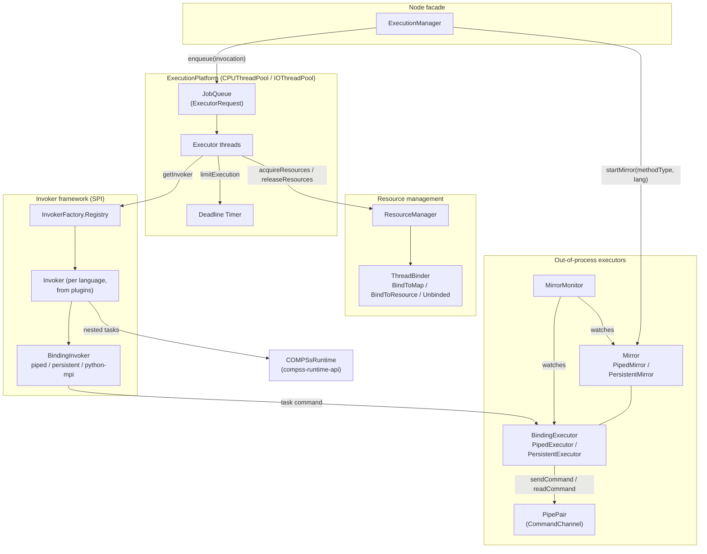
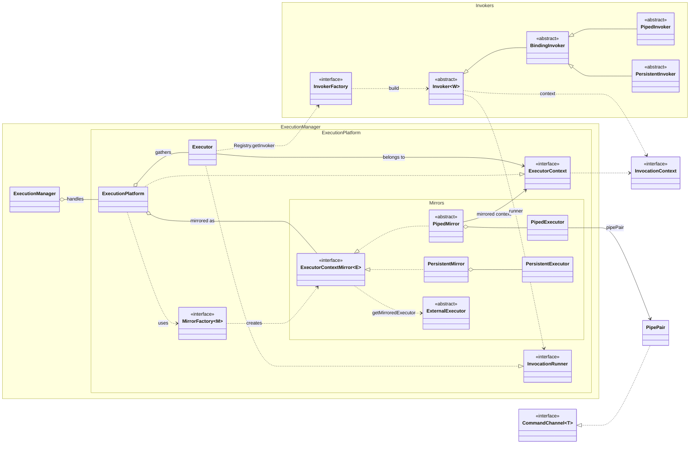
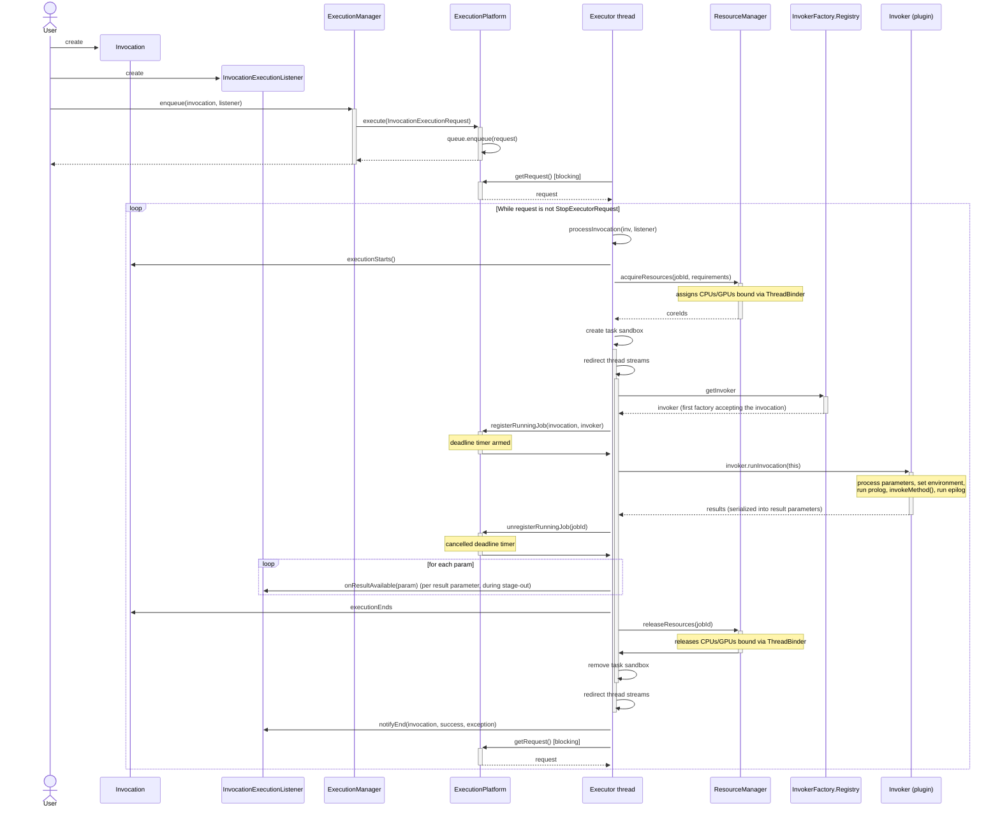

# compss-execution-core architecture

High-level architecture of the `core` submodule of
[compss-execution](../../README.md). This document describes how the
engine components interact at runtime and how their interfaces and
implementations relate; the per-package functionality inventory lives
in the [core README](../README.md).

## Overview

The engine runs on every worker node of a COMPSs deployment. Its entry point
is the `ExecutionManager` facade, which owns the thread pools that host task
executions (`ExecutionPlatform`), the node resource accounting
(`ResourceManager`) and the language mirrors. A task arrives as an
`Invocation` (contract from `api`), is wrapped into an
`InvocationExecutionRequest` and is picked by an `Executor` thread, which
reserves resources, builds a task sandbox and delegates the user code
execution to a language `Invoker` resolved through the `InvokerFactory` SPI
(implemented by the `plugins` submodule). Language runtimes that cannot live
in the same process are driven through `BindingInvoker` variants that
delegate the task to a language binding outside the JVM: the piped family
exchanges a command string with the external process over a
`CommandChannel`, while the persistent family calls the persistent C
binding through JNI.

## Component diagram

## Interfaces and implementations

The class diagram below shows how the main contracts of the module
relate to their implementations.

- **`InvocationContext`** (contract from `api`): everything an
  invocation needs from its environment: node configuration, thread
  streams, parameter load/store operations and the runtime API entry
  point for nested tasks. It is implemented outside the execution
  module by the worker adaptors (`NIOWorker`, `GOSWorker`,
  `COMPSsMaster`); `test-commons` provides `FakeInvocationContext`.
- **`ExecutorContext`** (core): the execution platform as seen by
  executors, invoker factories and mirrors: request dispatch
  (`newThread`/`getJob`), resource management, running-job registry
  (deadline timer), the mirror registry
  (`getMirror`/`registerMirror`) and the mirrored-executor lookup
  (`getMirroredExecutor`: the synchronized find-or-create of the mirror
  through its `MirrorFactory`, then the mirror's thread-local executor).
  `ExecutionPlatform` is its only implementation in the core, hosting the
  thread pools, the `JobQueue`, the `ResourceManager` and the deadline
  `Timer`.
- **`Executor`**: a worker thread of the platform. It implements
  `InvocationRunner` so that invokers can stall it while a blocked
  nested workflow runs and wake it up afterwards.
- **`Invoker`**: abstract base of all language invokers. It implements
  `WorkflowListener` (workflow API) to track nested task groups.
  In-process invokers extend it directly (`JavaInvoker` in the java
  plugin, plus the binary and opencl plugins), while out-of-process
  execution goes through `BindingInvoker`, which delegates the task to a
  language binding outside the JVM: its constructor builds the task
  command in two steps (the subclass execution command through
  `getTaskExecutionCommand`, then the generic external arguments —
  affinities, hostlist, parameters — appended by the base class), and
  its tail unifies the exit-value check and the result application
  (`checkExitValue`/`applyTaskResults`). Its specializations are
  `PipedInvoker` (C, Python, R — exchanges the command with the piped
  process through its executor handle's `CommandChannel`),
  `PersistentInvoker` (persistent C — synchronous calls into the JNI
  binding) and `PythonMPIInvoker` (binary plugin).
- **`InvokerFactory`**: SPI implemented by every language plugin and
  discovered through `ServiceLoader`. `preLoad` starts and registers
  the language mirror on the platform and `build` creates the
  invoker, fetching its executor handle through the platform's
  mirrored-executor lookup. `CInvokerFactory` is shown as an example.
- **`ExecutorContextMirror`**: mirrors an execution platform into
  external processes. `registerExecutor(Executor)` returns the handle
  (`E`) used to command the process of that executor;
  `getMirroredExecutor(Executor)` is the lazy thread-local lookup that
  re-registers a handle when the previous one can no longer run, and
  `cancelJob(E)` cancels through the same handle type, keeping the
  contract transport-agnostic. Each mirror owns its executor registry
  and its per-thread handle cache: `PipedMirror` (pipe-based, holding
  the pipe pool and specialized per language by `CMirror`,
  `PythonMirror` and `RMirror`) and `PersistentMirror` (persistent
  backends, managing the thread-binding lifecycle). The command
  protocol is `CommandChannel` (`sendCommand`/`readCommand`),
  implemented by `PipePair`, which is what `PipedInvoker` and
  `PipedExecutor` exchange commands through.
- **`ExternalExecutor`**: abstract base of the runtime-side handles to
  out-of-process executors. It owns the handle lifecycle as a state
  machine (CREATING, RUNNING, STOPPING, DELETED with final transition
  methods), so every handle follows the same enforced contract:
  `PipedExecutor` adds its mirror and pipe pair, `PersistentExecutor`
  adds its owning executor thread. The persistent JNI bridge
  (`PersistentCBinding`) owns the native entry points of the persistent
  C binding: the invoker calls `executeInBinding` with the task command
  string, and the mirror initializes and finishes the thread binding on
  executor registration and unregistration.

## Execution flow of an invocation

Activation bars in the diagram show the interval during which each
component is busy processing a call. The submission chain
(`ExecutionManager` and `ExecutionPlatform`) is only active until the
request is queued, while the executor thread remains active for the
whole processing of each request.

Step by step:

1. **Submission.** The caller first builds the task description
   (`Invocation`) and the listener that will receive its completion
   callbacks (`InvocationExecutionListener`), and then passes both to
   `ExecutionManager.enqueue`, which wraps them into an
   `InvocationExecutionRequest`. IO-bound executions (e.g. object streams)
   are routed to the dedicated `IOThreadPool`, the rest to the
   `CPUThreadPool`. The whole submission chain is asynchronous: the platform
   only inserts the request into its `JobQueue` and both
   `ExecutionPlatform.execute` and `ExecutionManager.enqueue` return
   immediately, without waiting for the job to end.
2. **Dispatch.** Each `ExecutionPlatform` keeps a `JobQueue` of pending
   requests. `Executor` threads pull them: the thread registers itself with
   `newThread()` and then loops over `getJob()`, which blocks until a
   request arrives (or a stop request terminates the loop with a
   `StopExecutorException`).
3. **Resource reservation.** Before running, the executor acquires the
   resources described by `invocation.getRequirements()` from the
   `ResourceManager`, which assigns concrete CPUs/GPUs and optionally binds
   the executor thread through the configured `ThreadBinder`. If resources
   are exhausted, the request blocks in the manager's pending requests until
   a release wakes it up.
4. **Sandbox and streams.** The executor creates the task working directory
   (sandbox), registers the job outputs and redirects the thread's
   stdout/stderr (`ThreadedPrintStream` and per-thread `System` properties
   via `ThreadedProperties`) so that concurrent tasks on the same node write
   to their own files.
5. **Invoker resolution.** `InvokerFactory.Registry.getInvoker` asks every
   factory supporting the invocation's `MethodType` to build an invoker; the
   first factory whose language matches wins. This is the extension point
   that decouples the engine from the language plugins.
6. **Execution.** The executor registers the running job (arming the
   platform deadline timer with the invocation timeout) and calls
   `invoker.runInvocation(this)`. The base `Invoker` parses the parameters,
   sets the execution environment variables, runs the prolog, calls the
   plugin's `invokeMethod()`, and runs the epilog. Task tracing and data
   provenance events are emitted around the method invocation.
7. **Release and notification.** The executor unregisters the job and
   releases the resources back to the `ResourceManager`. During the
   stage-out of the result parameters it reports every result through
   `InvocationExecutionListener.onResultAvailable(param)`, and once the
   invocation ends (`invocation.executionEnds()`) the request itself reports
   the job outcome with `notifyEnd(invocation, success, exception)`:
   success, the `WorkflowException` of a failed task group, or the failure
   flag of any other error. On timeout, the platform timer cancels the
   invoker (`invoker.cancel()`).

## Resource handling

The `ResourceManager` is the single owner of the node capabilities (CPU,
GPU, FPGA and other computing units). `acquireResources` assigns units per
job id, honoring the resource description of each invocation and the
configured binding map; `releaseResources` returns them. When an invocation
blocks on a nested-task synchronization, the platform may release its
resources for other tasks and re-acquire them when the code is ready to
continue (`Executor.stalledCodeExecution` / `readyToContinueExecution`,
controlled by the `reuseResourcesOnBlockedInvocation` platform setting and
implemented through the `Invoker` `WorkflowListener` callbacks).

Thread affinity is applied by the `ThreadBinder` implementation selected at
startup: `BindToMap` (fixed map from `lscpu` or user configuration),
`BindToResource` (cores of the hosting resource) or `Unbinded` (no binding).

## Out-of-process executors

Languages whose runtime cannot be embedded in the Java worker (Python, C)
are executed in external processes:

- **Piped** (`PipedInvoker` / `PipedExecutor`): the `PipedMirror` starts a
  piper process (the `bindings_piper.sh` script of the NIO adaptor) and
  creates one `PipedExecutor` per task, connected through a `PipePair`.
  The invoker owns the executor handle, derives its command channel
  from it and serializes the execution request into an
  `ExecuteTaskExternalCommand` built by the `BindingInvoker` constructor;
  it reads back task events over the same protocol; all commands are the
  `ExternalCommand` implementations of the `executor.external.commands`
  package (task execution and cancellation, task groups, files, objects,
  barriers, channels, worker lifecycle).
  The `MirrorMonitor` watches the mirrored elements (files, objects, task
  groups) so the worker can react to their lifecycle.
- **Persistent** (`PersistentInvoker` / `PersistentExecutor`): the external
  executor is a long-lived process whose state survives across
  invocations, avoiding the per-task startup cost. It does not exchange
  commands over a channel: the invoker hands the same command string to
  the persistent C binding through JNI (`PersistentCBinding
  .executeInBinding`), which executes it on the binding of the calling
  executor thread and reports back an `ExternalTaskStatus` that drives
  the shared result handling. The mirror manages the thread-binding
  lifecycle, initializing the binding when an executor thread registers
  and finishing it on unregistration; since jobs run as synchronous
  native calls on the executor thread, there is nothing to cancel from
  the outside.

The platform starts a mirror per (method type, language) pair on demand:
`ExecutionManager.startMirror` triggers `InvokerFactory.Registry.preLoad`,
which lets the matching plugin boot its language infrastructure.

## Nested tasks

An invocation may detect more parallelism than declared (e.g. a Python task
that spawns other tasks through the COMPSs API). The invoker then registers
a workflow with the runtime API obtained from the context
(`context.getRuntimeAPI()`) and becomes a *nested application*: input files
are registered in the workflow, the invocation waits on `wf.barrier()` for
all its nested tasks, and the results bound by the nested tasks are
forwarded to the outer invocation parameters (`resultIsForwarded`). While
the nested workflow runs, the invoker releases and re-acquires the hosting
thread's resources through the `InvocationRunner` callbacks described
above.
